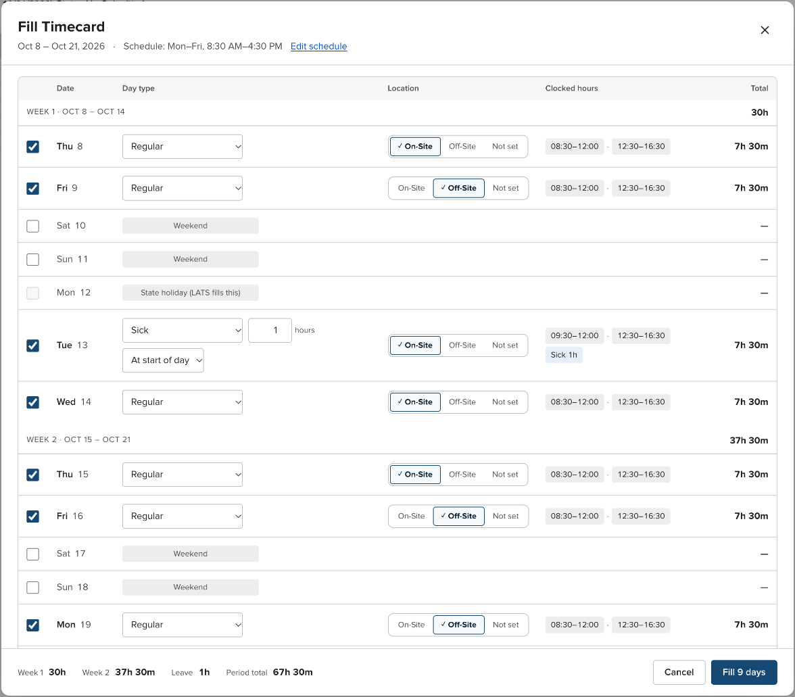

# LATS Go!

LATS Go! is a Chrome extension that makes the New York State Leave and Accrual Tracking System (LATS) faster to use. It fills your timesheet from your schedule, handles leave and work location, and helps you finish time distribution (TDS).



## Install

Install [LATS Go! from the Chrome Web Store](https://chromewebstore.google.com/detail/lats-go-%F0%9F%8E%89/obdmohilnmnjkdjgkbcjfaifiilikhip).

To install from source instead:

1. Clone or download this repository.
1. In Chrome, go to `chrome://extensions/`.
1. Turn on **Developer mode**.
1. Select **Load unpacked**, and then select this folder.

LATS Go! needs Chrome 111 or later.

## Features

### Fill Timecard

On an editable timesheet, select **Fill Timecard** next to **Save**. The dialog lists every day in the pay period as a week table. For each day, you can do the following:

- Include or skip the day. Your scheduled workdays are selected for you.
- Choose a day type: Regular, Vacation, Sick, Sick Family, Personal, Holiday leave (balance), or Floater.
- Charge partial-day leave, from 0.5 to 7.5 hours. LATS Go! moves Day In later, or Day Out earlier, so the day still adds up to your schedule. For example, 1 hour of sick leave on an 8:30 AM day becomes Day In 9:30 AM plus Sick 1.
- Set the work location to On-Site, Off-Site, or Not set. Not set leaves LATS's boxes as they are. Leave-only days get neither box.

The dialog shows each day's clocked hours and total, plus weekly and period totals, before you apply. It works with the keyboard alone, and Escape closes it.

LATS recalculates its own totals only when you save. After you fill, select **Save** in LATS to update them.

LATS Go! never submits a timesheet. Submitting requires your attestation, so it always stays your action.

### State holidays

LATS Go! finds LATS's "Holiday - MM/DD/YYYY" notices and skips those days. When you save, LATS adds the "HOL - State Holiday" row itself. Use the **Holiday leave (balance)** day type only to charge banked holiday leave.

On the timesheet and TDS pages, LATS's holiday notices show as a **State holiday reminder**. It names the period's holidays and links to the Department of Civil Service holiday calendar for that year. On the timesheet, until LATS adds the HOL row, it also tells you that LATS adds 7.5 hours of HOL - State Holiday when you save.

### Your schedule

Open the settings from the toolbar icon (**Edit schedule**) or from the Fill Timecard dialog. You can set the following:

- Which days you work, including Saturday and Sunday.
- Your times for each day: time in, lunch out, lunch in, and time out. Lunch is optional.
- Your usual location for each day.
- Two alternating weekly schedules. Week 1 is the first week of each pay period.
- Whether partial-day leave starts your day later or ends it earlier.

LATS Go! checks that each day's times are in order. LATS reads times in order, and a time earlier than the one before it wraps to the next day.

If you used an earlier version, LATS Go! converts your Week 1 and Week 2 presets to the new schedule the first time it loads.

### Locked periods

LATS unlocks pay periods in order. When a period is locked, LATS Go! replaces Fill Timecard with a note that explains why, and an **Open oldest overdue** button that opens LATS's Overdue Timesheets list.

### Time distribution (TDS)

- **Remaining row.** Under TDS Totals, a Remaining row shows Work Totals minus the hours you've entered for each day, and it updates as you type. Each task row also shows a running total.
- **Copy rows from last period.** When a TDS page has no task rows, select **Copy rows from last period** to add the task and sub-task rows from your last period. LATS Go! remembers the rows from each TDS page you open, so open last period's TDS page at least once first. It lists any rows it couldn't add, such as a code that LATS retired.

### A cleaner LATS

LATS Go! restyles the timesheet and TDS pages to match its own UI:

- The Timesheet and TDS tabs come first in the tab bar, styled like the NY State Design System's tabs.
- Day columns show the weekday over the date, weekends are muted, and state holidays are tagged.
- A Total column shows each hours row's and totals row's period sum, in LATS's decimal hours.
- Rows with no hours on any day, such as unused leave types, hide behind **Empty rows**. The button shows how many rows it hides, and its tooltip names the first three.
- The tables under the timesheet, such as Work Totals and Balances and Earnings, have a line under each row.
- On the timesheet, LATS's warnings about missing time and unmatched TDS hours show as warning alerts.
- Each TDS row shows its sub-task or task name over its codes, with the hours and a row total on the same line.
- The timesheet status shows as a labeled pill.

The styling and the TDS helpers stay in place when LATS redraws the TDS grid, such as after you change a sub-task.

LATS Go! only adds elements around LATS's fields. It never renames, removes, or reorders them.

### Session recovery

If LATS shows an application error, select **Reboot LATS** on the error page. LATS Go! clears your LATS cookies and reloads the site.

## Permissions and privacy

| Permission | Why LATS Go! needs it |
|---|---|
| `storage` | Saves your schedule in Chrome sync storage, and remembers recent TDS rows in local storage. |
| `cookies` | Clears LATS cookies when you select **Reboot LATS**. |
| Access to `*.lats.ny.gov` | Adds Fill Timecard, the TDS helpers, and the styling to LATS pages. LATS Go! runs on no other sites. |

LATS Go! doesn't send your data anywhere. It has no servers, analytics, or third-party code.

## Development

LATS Go! is plain JavaScript with no build step. Chrome loads the files as they are.

```bash
npm install     # Install ESLint, Vitest, and jsdom
npm run lint    # Lint scripts/ and tests/
npm test        # Run the unit and integration tests
```

After you change code, reload the extension on `chrome://extensions/`, and then reload the LATS tab.

| Path | Purpose |
|---|---|
| `scripts/shared/utils.js` | Shared logic on the `LatsGo` global: settings and migration, time math, partial-day leave, page-text parsing, and the helpers that build LATS Go!'s elements and watch LATS for changes. |
| `scripts/content.js` | Timesheet and TDS pages: Fill Timecard, the locked-period note, and the TDS helpers. |
| `scripts/lats-restyle.js` | Small additions to LATS's own pages that `styles/content.css` builds on. |
| `scripts/page-bridge.js` | Runs in the page's main world to call LATS's jQuery, Kendo widgets, and dialogs. |
| `scripts/options.js`, `scripts/popup.js` | Settings page and toolbar popup. |
| `styles/ui.css` | One stylesheet for the popup, settings page, Fill Timecard dialog, and alerts, built on `styles/nysds-tokens.css`. |
| `styles/content.css`, `styles/default.css` | Restyling for LATS's own pages. |
| `tests/` | Vitest tests. `tests/fixtures/` holds synthetic LATS pages, not captures of real ones. |

The requirements for upcoming work are in [the next-release requirements](docs/requirements/next-release.md).
